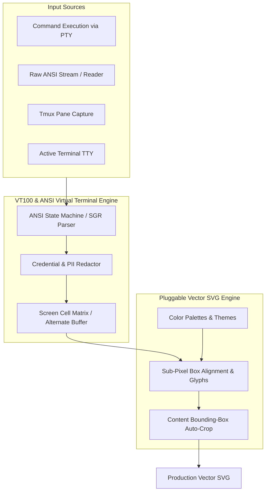

# golang-term2svg

[](https://pkg.go.dev/github.com/smford/golang-term2svg)
[](https://github.com/smford/golang-term2svg/releases)
[](https://github.com/smford/golang-term2svg/actions/workflows/ci.yml)
[](https://github.com/smford/golang-term2svg/actions/workflows/sast.yml)
[](https://github.com/smford/golang-term2svg/actions/workflows/scorecard.yml)
[](.golangci.yml)
[](.github/dependabot.yml)
[](https://opensource.org/licenses/MIT)

**`golang-term2svg`** is a production-grade Go module and CLI tool that converts live terminal commands, raw ANSI streams, tmux panes, and screen models into crisp, vector-rendered SVG graphics matching modern dark TUI aesthetics.

---

## Architecture & Pipeline



---

## Features

- **VT100 & ANSI State Machine (`pkg/termscreen`)**: Parses 16-color, 256-color, TrueColor (24-bit RGB), SGR styles (`bold`, `dim`, `italic`, `underline`, `inverse`), and alternate screen buffer switching (`CSI ? 1049 h/l`).
- **Pluggable Vector SVG Engine (`pkg/svgrender`)**: Emits customizable, scalable SVG graphics with card borders, drop shadows, and top navigation tabs.
- **Sub-Pixel Grid Alignment**: Isolates Unicode box-drawing glyphs (`U+2500` - `U+257F`) and calculates explicit `x` coordinates to guarantee pixel-perfect vertical alignment across font engines.
- **Hyperlinks (OSC 8)**: Translates terminal hyperlink escapes into native clickable SVG `<a href="...">` tags.
- **Background Fills**: Emits background `<rect>` fills for highlighted cell spans, progress meters, and selection blocks.
- **Double-Width Runes (CJK / Emojis)**: Integrates `go-runewidth` to correctly allocate character cell spans.
- **Secret Redaction Pipeline (`pkg/redact`)**: Automatically sanitizes IPs, Bearer tokens, API keys, passwords, and JWTs.
- **Auto-Crop**: Automatically calculates bounding boxes and shrinks the SVG canvas down to actual visible content.

---

## Installation

### Go Module
```bash
go get github.com/smford/golang-term2svg
```

### CLI Tool
```bash
# Via Homebrew
brew install smford/tap/term2svg

# Or directly install via go
go install github.com/smford/golang-term2svg/cmd/term2svg@latest
```

---

## Quick Start

### 1. Render a Shell Command
```go
package main

import (
    "context"
    "os"
    "github.com/smford/golang-term2svg"
)

func main() {
    svg, err := term2svg.CommandToSVG(context.Background(), "kubectl", []string{"get", "pods"}, term2svg.Options{
        Title:       "Kubernetes Pods",
        Theme:       "catppuccin",
        Tabs:        []string{"Workloads", "Pods", "Ingresses"},
        ActiveTab:   1,
        CardHeader:  "Observability Namespace",
        StatusBadge: "HEALTHY",
        AutoCrop:    true,
        ShowCursor:  true,
    })
    if err != nil {
        panic(err)
    }

    _ = os.WriteFile("pods.svg", []byte(svg), 0644)
}
```

### 2. Render from an ANSI Stream
```go
svg, err := term2svg.ReaderToSVG(reader, term2svg.Options{
    Title:       "Incident Logs",
    Theme:       "dark",
    MaskSecrets: true,
    AutoCrop:    true,
})
```

### 3. Snapshot a Live Tmux Pane
```go
svg, err := term2svg.TmuxToSVG("%1", term2svg.Options{
    Title: "Active Session",
})
```

### 4. CLI Usage
```bash
# Render a command directly
term2svg --title "Directory Listing" --output listing.svg -- ls -la

# Redact sensitive information from log pipes
cat incident.log | term2svg --mask-secrets --title "Redacted Audit Log" > audit.svg
```

---

## Engineering & DevSecOps Standards

This module is maintained with high reliability and zero-trust DevSecOps standards:
- **Strict 40-Character SHA Pinning**: All GitHub Actions are pinned to immutable commit hashes.
- **Static Application Security Testing (SAST)**: CodeQL (`security-extended`) and Semgrep OSS.
- **Supply Chain Security**: OpenSSF Scorecard auditing and keyless Sigstore Cosign binary signing.
- **Automated Dependency Updates**: Weekly Dependabot updates with autonomous auto-merge and patch releases.
- **Pre-commit Shift-Left Verification**: File hygiene, Gitleaks secret detection, ShellCheck, and Conventional Commits enforcement.

---

## License

[MIT](LICENSE) © 2026 smford
